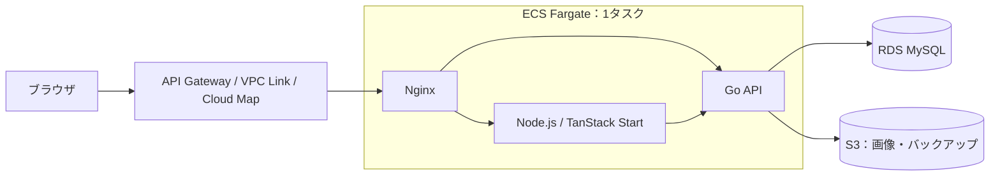

# course-k-blog

自分のサイトで書く記事と、note・Qiita・Wantedlyに書いた記事を、公開日順にまとめて読める個人ブログです。複数の媒体に分かれた発信を一か所からたどれるようにしています。外部記事はタイトル・公開日・リンクを掲載し、本文は元の媒体で読めます。

**公開サイト：[blog.course-k.com](https://blog.course-k.com/)**

自分で継続して使うサイトとして開発しながら、Reactの画面設計、GoによるAPI開発、AWSでの運用を学んでいます。

## できること

- **記事を読む**：自作記事と外部記事を新しい順に表示。自作記事はSSRで本文HTMLを配信します。
- **記事を書く**：Markdownとプレビューで編集し、下書き保存・公開・更新・非公開化ができます。
- **画像を載せる**：PNG/JPEGを記事へ挿入できます。下書きや未公開の差し替え画像は、本人だけが閲覧できます。
- **外部記事をまとめる**：本人の記事を定期取得し、タイトル・公開日の補正や一覧からの非表示を管理できます。
- **保存状態を確認する**：同期やバックアップの成功・失敗を管理画面で確認できます。変更に応じたバックアップと、別DB・画像保存先への復元に対応しています。

執筆・管理は本人一人を対象としています。コメント・いいね・複数執筆者・サイト内検索は実装していません。

## 構成

React / TypeScriptで公開画面と編集画面を作り、TanStack StartがSSRを担当します。認証・記事の公開判断・保存・外部同期はGo APIに集約しています。



本番はAWSオレゴンで稼働しています。Node.js・Go・Nginxは別コンテナとしてビルドし、同じFargateタスクで配備します。DBとS3バケットは非公開です。本番の本人認証にはCognitoと認証アプリのMFAを使います。

| 選択 | 重視したこと・受け入れた制約 |
|---|---|
| ReactとTanStack Startで画面を統一 | Reactへの習熟と編集画面の状態管理を活かし、公開画面も同じ部品で改良できることを優先。GoのHTMLテンプレートでも実現できますが、今回はNode.jsとGoの運用を受け入れています |
| ECS FargateとRDS MySQL | AWSのサービスの幅と実務学習、ホストOSやDB基盤の保守負担を重視。MySQLは本人の習熟を優先しています。実行資源の常時課金とAWS設定の管理は残ります |
| 3コンテナを1タスクに配置 | 小規模な個人運用での費用と管理の簡潔さを優先。更新・停止・資源・タスクIAMを共有し、各コンテナを独立して拡張できない制約があります |

比較した選択肢と判断の詳細は[設計書](docs/current-design.md)、配色・文字組み・操作配置の理由は[UI設計](docs/ui-ux-decisions-current.md)にまとめています。

## 実装で重視していること

- **編集内容を意図せず公開しない**：作業版と公開版を分け、公開中の記事を下書き保存しても読者が見る内容を維持します。本文と画像参照は同じDBトランザクションで更新します。
- **通信失敗を保存失敗と決めつけない**：応答が失われた場合は入力を保持し、保存結果を照合します。新規作成には作成キーを使い、同じ操作の再試行による重複を防ぎます。
- **検証した範囲を分ける**：固定APIの画面試験、実MySQL、ブラウザからの通し試験、実AWSの確認を区別します。バックアップは作成だけでなく別RDSへの復元も確認しています。

## ローカルで動かす

Docker Compose 2.24.4以上、Node.js 24以上、Go 1.27以上が必要です。初回設定の生成でもホスト上のGoを使います。依存パッケージ・コンテナイメージの取得にネットワークを使います。

初回はリポジトリを取得し、次を実行します。

```sh
git clone https://github.com/course-k/course-k-blog.git
cd course-k-blog
node scripts/setup-local.mjs
docker compose up --build
```

- 記事一覧：`http://localhost:8080`
- 管理画面：`http://localhost:8080/admin`
- ローカル用ログイン情報：生成された`config/local-login.txt`

設定生成は初回だけです。設定がすでにある場合はComposeを起動します。既存設定は自動上書きしません。通常の停止は`docker compose down`です。`down -v`はDB・画像・バックアップのボリュームも削除します。

ローカルはCaddy・MySQL・ファイル保存・ローカル認証を使い、本番はNginx・RDS・S3・Cognitoを使います。詳しい起動・テスト・設定の復旧方法は[開発ガイド](docs/development.md)を参照してください。

## コードとドキュメント

| 場所 | 内容 |
|---|---|
| [frontend/](frontend/) | Reactの画面、SSR、Markdown表示、編集操作とテスト |
| [backend/](backend/) | Go API、認証、記事・画像・外部同期、MySQLとテスト |
| [infra/](infra/) | AWS構成、Nginx、DB初期化、監視 |
| [scripts/](scripts/) | 開発・検証・構成生成の補助 |
| [docs/](docs/) | 設計・UI・検証結果・開発手順 |

- [設計書](docs/current-design.md)：要件、責務、API・DB、比較と選定理由
- [開発ガイド](docs/development.md)：ローカル起動、各テストの実行方法、CIの範囲
- [本番運用](infra/production.md)：配置・更新、認証、バックアップ・復旧
- [確認結果と制約](docs/blog-publication-roadmap-2026-10-18.md)：本番で確認した範囲と未確認事項
- [文書索引](docs/README.md)：その他の資料への案内

## LLMの利用

Codexを通じてLLMを、要件整理、技術比較、UI案、コード・設定・テストの生成と修正、文書化、配置・検証作業の補助に広く利用しています。

本人は目的・要件・選定の優先順位、技術・費用・UIの主要な採用判断、最終画面の確認を担当しています。実装の確認にはソースとの照合、CI、実環境の検証を用いています。確認した範囲と限界は検証結果に記録しています。利用範囲と品質方針は[設計書第12・13節](docs/current-design.md#12-実装参照とllm利用)に記載しています。

## 保守者

[course-k](https://github.com/course-k)が開発・運用しています。
