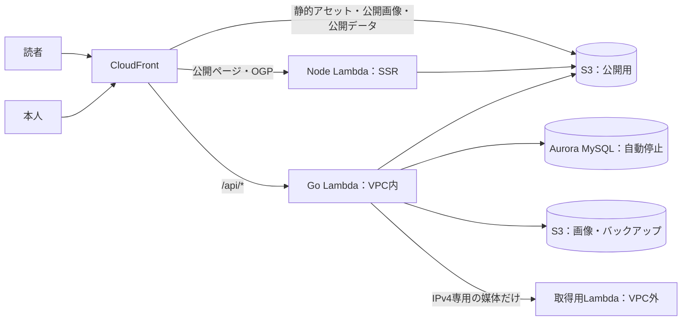

# 移行設計：常駐をやめる配信構成とAurora自動停止

最終更新：2026-11-11。

**状態：本人が移行を決定（2026-11-11）。実装・AWS設定の変更は未着手。** 本番は[現行設計](current-design.md)のFargate構成で稼働している。本書は移行先の構成・費用・作業順を定める。実装と本番切替が済んだ部分から現行設計へ移し、進捗は[公開台帳](blog-publication-roadmap-2026-10-18.md)で管理する。

## 目的と前提

月額を現在の約35 USD（税別）から5 USD前後へ下げる。本人は現在の額を許容できないと判断し、DBはAuroraの自動停止を選んだ。

| 前提 | 内容 |
|---|---|
| 費用の実績 | 2026年11月1日〜11日朝の請求見積もりは税込12.61 USD。ECS 5.30、RDS 4.34、VPC 1.14、Route 53 0.50、Secrets Manager 0.13、税1.15。10月は税込17.11 USD |
| 費用の性質 | 常駐するFargateタスクとRDSインスタンスの時間課金が税別額の84％。本番の一覧負荷試験ではCPU平均2.81％で、処理量を減らしても額は変わらない |
| 待ち時間の許容 | 閲覧は速く保つ。記事の保存・更新・管理操作は待ち時間を許容する（本人の意向） |
| 維持するもの | React／TypeScript・TanStack Start、Go、MySQL互換のスキーマとSQL、Cognito認証、画像の署名付きS3 POST、変更に応じたバックアップ |

## 構成

読者の経路からDBを外し、DBに触れるのは本人の管理操作だけにする。DBが停止していても公開ページは表示できる。

| 役割 | 配置 | 動くとき |
|---|---|---|
| 入口・キャッシュ | CloudFront。独自ドメインとus-east-1のACM証明書 | 常時 |
| 公開ページのHTML・記事OGP | Node Lambda（VPC外）。現行のSSRエントリーをそのまま使い、記事データは公開用S3のJSONから読む | CloudFrontにキャッシュがないとき |
| JS・CSS・題字等、公開画像、公開データJSON | 非公開S3をCloudFrontのアクセス制御で配信 | 常時 |
| 認証・記事の保存と公開・画像登録・外部同期・バックアップ | Go Lambda（VPC内）。現行のHTTPサーバーをそのまま動かす | 管理操作のとき |
| 本文・下書き・公開版・セッション等 | Aurora MySQL Serverless v2、最小0 ACU、単一インスタンス | 管理操作のとき。無操作5分で停止 |
| note・Wantedlyの取得 | 取得用Lambda（VPC外）。許可した取得先だけを代理取得 | 本人が同期を要求したとき |

不要になる資材：ECSクラスタとサービス、Nginx、Cloud Map、VPC Link、API Gateway、公開IPv4、RDS MySQLインスタンス。

### 読者の経路：CloudFrontのキャッシュとNode Lambda

公開ページは現行のSSRをLambdaで実行し、CloudFrontが長期間キャッシュする。記事の公開・更新・非公開化・外部同期のときに、GoがCloudFrontのキャッシュを無効化する。

- Nodeは`API_BASE_URL`の向き先を公開用S3のJSONへ変える。Goは公開内容が変わる操作と同じ要求の中で、一覧の各ページ・月別・各記事のJSONを現在のAPI応答と同じ形で書き出す。全件を毎回書き直し、途中失敗は次の操作か手動の再実行で回復する。
- 画面遷移で使うServer FunctionsもNode Lambdaが処理し、同じJSONを読む。
- キャッシュがないときの応答時間はNode Lambdaの起動時間で決まる。DBの再開待ちは発生しない。
- 現行の`Cache-Control: no-store`は、公開ページとOGPではCloudFront向けの保持時間へ変える。管理画面とAPIはキャッシュしない。

### 公開画像

公開版が参照する画像は、公開時に公開用S3へ現在のURLと同じパスで置く。CloudFrontは`/api/images/*`を公開用S3から返し、存在しないときだけGo Lambdaへ切り替える。Goは現行どおりセッションを確かめ、本人にだけ下書き・差し替え画像を返す。

非公開化のときは公開用S3から該当ファイルを消し、キャッシュを無効化する。反映には数十秒から数分かかる。読者のブラウザに残ったコピーは回収できない。

### Go Lambda：VPC内とIPv6の出口

Goは現行のMySQLドライバとSQLを変えずにAuroraへ接続するため、VPC内に置く。外向きの通信は次のとおりにし、NAT Gatewayと公開IPv4を持たない。

| 通信先 | 経路 | 確認した根拠 |
|---|---|---|
| Aurora | VPC内のプライベート接続 | — |
| S3 | ゲートウェイエンドポイント（無料） | — |
| Cognito（OIDCの設定・鍵・トークン交換） | デュアルスタックのサブネットとEgress-Only Internet GatewayによるIPv6 | 2026-11-11に`cognito-idp.us-west-2.amazonaws.com`と`*.auth.us-west-2.amazoncognito.com`のAAAAレコードを確認 |
| Qiita API | 同上 | `qiita.com`のAAAAレコードを確認 |
| SSM・Lambda・CloudFrontのAPI | 同上。デュアルスタックのエンドポイントを使う | `ssm.us-west-2.api.aws`・`lambda.us-west-2.api.aws`のAAAAレコードを確認。CloudFrontのAPIは未確認 |
| note・Wantedly | 取得用Lambdaを呼び出して代理取得 | `note.com`・`www.wantedly.com`にAAAAレコードなし |

取得用Lambdaは取得先を現行の許可リストに限定し、DB・S3・秘密値への権限を持たない。

### 常駐処理の置き換え

Lambdaは応答後に凍結されるため、現行の常駐ループを次のように変える。

| 現行 | 変更後 |
|---|---|
| 外部同期（30秒ごとに要求を確認） | 同期要求を受けたGoが、同じ関数を非同期で呼び出して処理する |
| バックアップ（15秒ごとに変更世代を確認） | 変更を伴う操作の後に、同じ非同期呼び出しで取得する |
| 一時アップロードの掃除（1時間ごと） | 管理操作の機会に実行する。S3側の1日期限は維持する |
| DB接続の保持（最大5、アイドル2） | 要求ごとに閉じる。凍結中の接続が残るとAuroraが停止しないため |

### Auroraの自動停止に合わせる変更

- 接続の待ち時間を60秒へ延ばす。再開は通常約15秒、24時間を超えて停止した後は30秒以上かかる場合がある。CloudFrontのオリジン応答待ちも60秒にする。
- 管理画面は、最初の操作が再開待ちで遅いことを表示する。
- 疎通監視は`/api/readyz`（DBへ接続する）を対象から外し、公開ページと`/healthz`だけにする。定期的にDBへ触れる処理を置かない。
- RDS Proxyとバイナリログのレプリケーションは使わない。どちらも停止を妨げる。
- エンジンはAurora MySQL 3.08.0以上。現行のMySQL 8.4向けSQLがAurora MySQL 3（MySQL 8.0互換）で動くことを、移行前に実DB試験で確かめる。

出典：[Auroraの自動停止・再開](https://docs.aws.amazon.com/AmazonRDS/latest/AuroraUserGuide/aurora-serverless-v2-auto-pause.html)、[VPC接続したLambdaとIPv6](https://docs.aws.amazon.com/lambda/latest/dg/configuration-vpc.html)。

## 月額の試算

オレゴン、オンデマンド、税別。Auroraの単価は2026-10-29版の[RDSオレゴン公式価格表](https://pricing.us-east-1.amazonaws.com/offers/v1.0/aws/AmazonRDS/current/us-west-2/index.csv)で確認した。使用量と無料枠の適用は仮定であり、検証結果ではない。

| 項目 | 計算の前提 | 月額USD |
|---|---|---:|
| Auroraの計算資源 | 0.12/ACU時。月20時間、平均1 ACUで稼働と仮定 | 約2.40 |
| Auroraの保存領域 | 0.10/GB月×1GB、I/Oは0.20/100万回で少量 | 約0.15 |
| Lambda | 月数万回・512MiB。毎月の無料枠内と仮定 | 0 |
| CloudFront | 毎月の無料枠内と仮定 | 0 |
| S3 | 数GBと少量の要求 | 約0.25 |
| CloudWatch | ログ1GB未満、アラーム10件以内 | 約0.50 |
| 秘密値 | SSMのSecureStringへ置く | 0 |
| **小計** | | **約3.30** |

Auroraの稼働時間が月60時間なら約4.80 USD増える。メンテナンスによる再開、無料枠の残り、キャッシュ無効化の超過、税、為替は含まない。Route 53（月0.50 USD）と既存のSecrets Manager（月0.40 USD）は、用途を確かめてから要否を決める。

## 現行コードから変わる箇所

| 対象 | 変更 |
|---|---|
| `frontend/src/lib/posts.ts` | 取得先を公開用JSONへ変える。月別・ページ分割のファイル名規則を定める |
| `frontend/runtime.mjs`・`server.mjs`・`ogp.mjs` | Lambdaで動かす入口と、公開ページ・OGPのキャッシュ指定 |
| `backend/cmd/api/main.go` | Lambdaでの起動、常駐ループの廃止、非同期処理の入口、接続待ち時間 |
| `backend/internal/mysql/connection.go` | 要求ごとに接続を閉じる設定 |
| `backend/internal/httpapi`（公開・非公開・同期） | 公開用JSONと公開画像の書き出し・削除、キャッシュ無効化 |
| `backend/internal/external` | IPv4専用の媒体を取得用Lambda経由にする切り替え |
| `backend/internal/backup` | 論理バックアップと復元は維持。起動のきっかけだけ変える |
| `infra/monitoring/probe.py` | 監視対象の変更 |
| `scripts/aws/`・`infra/`・`.github/workflows/` | 本番定義・権限・配備・受入確認を新構成向けに作り直す |
| `compose.yaml`・ローカル通し試験 | ローカルは現行のCompose構成を維持する。公開用JSONの書き出し先をローカルのディレクトリにして同じ経路を試験する |

DBのデータは、現行の論理バックアップをAuroraへ復元して移す。別DBへの復元は本番で確認済みの手順を使う。

## 作業順

各段階で止められるよう、本番を切り替えるのは最後にする。

| 順序 | 到達点 | 本番への影響 |
|---|---|---|
| 1 | 小さな検証：VPC内LambdaからIPv6でCognito・Qiita・SSMへ届くこと、Auroraの停止と再開時間、Aurora MySQL 3での全DB試験 | なし。検証用資材は数日で撤去、費用は1 USD未満の見込み |
| 2 | アプリの変更：公開用JSON・公開画像の書き出し、Lambdaでの起動、常駐処理の置き換え。ローカルとCIの試験を通す | なし。現行のFargateでも動く形を保つ |
| 3 | 新構成の本番定義・権限・配備ワークフロー | 新スタックを別名で作る。現行は稼働したまま |
| 4 | 並行稼働での受入：仮ホスト名で閲覧・執筆・公開・非公開・画像・同期・バックアップ・復元を確認 | 新旧が同時に動く間、費用が一時的に増える |
| 5 | 切替：書き込みを止め、バックアップをAuroraへ復元し、DNSをCloudFrontへ向ける | XServer DomainのCNAME変更。戻すときは同じレコードを旧値へ戻す |
| 6 | 旧構成の撤去：ECS・RDS・API Gateway等を削除。RDSは最終スナップショットを残す | 月額が下がる |

管理者ログインが要る作業は、段階1・3の権限定義の適用と段階5のDNS変更。

## 受入条件

- DBが停止した状態で、公開一覧・記事・画像・OGPが表示できる。
- JavaScriptを実行しない取得で、公開記事の本文HTMLが得られる。
- 公開・更新・非公開化が、数分以内に公開ページへ反映される。非公開化した記事と画像は404になる。
- 下書きと差し替え前の画像は、本人以外に404を返す。
- 無操作のあとAuroraが停止し、ACUの使用が0になる。
- 停止後の最初の管理操作が、再開を待って成功する。
- バックアップの取得と別DBへの復元が、新構成で成功する。
- 切替後1か月の請求で、月額が試算の範囲に収まる。

## 採用しなかった構成

- **ISR、またはFargateを残したままのCDNキャッシュ**：費用は常駐時間で決まるため、常駐サーバーを前提とする方式は対象外。
- **全ページを事前生成してS3へ置くSSG**：生成ジョブと「保存済みだが未反映」の状態管理が要る。Node Lambdaとキャッシュで閲覧時のDB接続をなくせるため、追加しない。キャッシュがないときの応答時間が問題になった場合に再検討する。
- **RDS Data API経由の接続**：応答が1MiBまでで、全記事の本文を返す管理一覧やバックアップの取得が上限に当たる。ローカルとCIの実MySQL試験とも経路が分かれるため、標準のMySQL接続を維持する。出典は[Data APIの制限](https://docs.aws.amazon.com/AmazonRDS/latest/AuroraUserGuide/data-api.limitations.html)。
- **DynamoDB**：本人がMySQL互換の維持を選んだ。
- **RDS MySQLの継続**：インスタンスの時間課金（月約14 USD）が残り、目標額に届かない。
- **サーバー1台へのCompose配置**：OSとDBの保守を自分で持たない方針を維持する。
- **NAT Gateway・NATインスタンス**：時間課金と公開IPv4が加わり、目標額に届かない。
